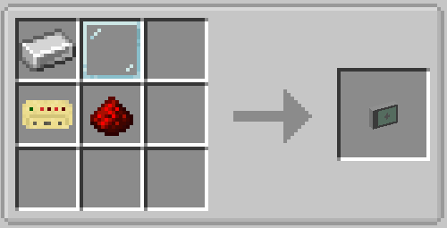

# Computed Glasses

The glasses are a wearable HUD. Wear them on your head and they show a status line for your
linked computer — plus up to 16 live widgets from your graph, right in the world.

!!! note "In development"
    Glasses are a new feature that is not part of the latest release yet.

{ width=420 }

## How it works

The glasses carry no binding of their own. They mirror the **first bound Link Card** they find on
you — main inventory first, then the offhand. Right-click a computer with a Link Card to bind it,
then put the card anywhere in your inventory and wear the glasses.

You now see a line like **Connected with: Base** (or the computer's x/y/z when it has no name).
Anyone linked to the same computer — drone pilot, plane crew, base operator — sees the same
widgets on their glasses.

## Showing graph widgets on the glasses

Use the **Glasses HUD** node (Widgets category) exactly like a Monitor node: it has 16 widget
inputs (`widget_1` … `widget_16`), **+** adds one, **−** removes the last. Wire any widget nodes
into it — text, numbers, buttons, progress bars — and every player wearing glasses linked to this
computer sees them.

## Adjusting the HUD (press K)

With the glasses equipped, press **K** to enter edit mode:

- **Double-click empty space** to add a new HUD line.
- **Drag** a line to move it, use the handle to resize, **double-click** to edit its text, color,
  and scale.
- The **Graph widgets** box moves and rescales the whole widget region.
- **Save** when you are done; **ESC** cancels.

Every HUD line is a text template. Available placeholders:

| Placeholder | Replaced with |
|---|---|
| `{computer}` | Computer name, or its position when unnamed |
| `{x}` `{y}` `{z}` | Computer coordinates |
| `{dimension}` | Dimension ID |

Positions and scales are stored per element (normalized 0–1, so they survive resolution and GUI
scale changes) in `config/computed-glasses-hud.json`.
