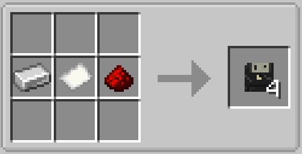

# Import and Export

The graph toolbar has one **Import / Export** menu beside the zoom controls. It keeps graph and node package actions together (plus **Set Computer ID**, which lets computers share those folders) and uses the same hover and selection treatment as the editor's other menus. Graph and node packages live in the world save under `<world>/computed/packages/<id>/graphs/` and `<world>/computed/packages/<id>/nodes/`, scoped to the computer's ID: computers that share an ID share the same folders, while other IDs cannot see them; all transfers go through the server, which also works on dedicated servers. Import presents the available `.computed` files and export asks for a name. Existing files can be overwritten or saved with the next ` (n)` suffix. Packages are limited to 1 MB per file. A graph package is a validated ZIP archive containing `manifest.json`, `graph.json`, and only the embedded Lua definitions used by the graph. Older exports that still sit in the game directory's `computed/` folder are copied into the computer's package folders automatically the first time a package dialog is used (once per computer ID; existing world files are never overwritten).

Both `graphs/` and `nodes/` inside a computer's package folder support subfolders. The import dialog shows folders first and lets you browse into them (`..` returns to the parent). Export names may include a path such as `planes/racers/sprint`; intermediate folders are created automatically. Existing user folders in the world save are picked up without conversion.

Programs can also travel on a **Program Disk** (an iron ingot, paper, and redstone make four disks):

{ width=420 }

The export dialog offers a **Disk** button beside **Save**, and **Export Selected Node** becomes **Export Node to Disk** while a disk is available. A disk can be held in the main hand or inserted into the computer's drive slot — shift-right-click the computer to open the peripheral bay, where the rightmost slot is the drive (shift-right-click while holding a disk inserts it directly). Exporting prefers the hand disk and falls back to the drive. The disk stores one package — a full graph archive or a single node source — as item data, and writing to it always replaces its previous content (the result reads `Saved to disk as …`). In the import dialogs a matching disk appears as the first entry whether it is held or inserted, so another player can load the program directly, even with a different computer ID.

Blank disks stack up to 16. A written disk glows and always stacks alone, and writing to a held stack writes exactly one disk while the rest stay blank. To wipe a written disk, craft it by itself in any crafting grid — the result is a blank disk again.

Right-click a **written** disk in your hand to toggle **autostart**: the action bar confirms
`Disk autostart: on`, the tooltip gains an aqua `Autostart: on` line, and inserting the disk
announces `Disk inserted — autostart armed`. The flagged disk loads and runs its graph as soon as
it sits in the drive of a computer with an empty program — at insertion time or at the first tick
after startup. A program already loaded on the computer always wins; eject it first to let the
disk start.

Node source files use the computer's `nodes/` folder and the `.lua` extension. **Import Node** is in the toolbar menu, while **Export Selected Node** is available there and in a user node's right-click menu. Import opens the selected Lua file in the Lua editor; export writes the source directly using the selected user node's title. Bundled and integration nodes cannot be exported, edited, or deleted.

Selected canvas nodes support Ctrl+C, Ctrl+X, and Ctrl+V. Pasted nodes are placed at the cursor and retain connections between nodes in the copied selection. Ctrl+D immediately clones the selection 24 pixels right and down; repeated presses continue from the latest clone to form a ladder.

The Lua editor also supports normal text selection and clipboard shortcuts. Use Ctrl+C to copy selected source and Ctrl+V to paste into editable user definitions. **Paste Lua** remains available from the empty-canvas context menu for clipboard imports.

For a new in-game definition, choose **User Nodes → New Lua Node…** in the Node Explorer. Saving the starter stores the source in the current computer and places the first instance.

Server validation checks the 64 KiB source limit, API version, definition ID, schema, hash, permissions, and the 256 embedded-definition limit. An identical ID/hash is a no-op. The same ID with different source requires explicit confirmation.

After replacement, instances recompile. Connections survive only when direction, stable port ID, and connection type all match. Removed or changed ports are reported before save.

CMP1, CMP2, format-2 graphs, JSON custom nodes, Functions, and Sections are not importable. Loading legacy world data initializes an empty format-3 program without backup.
