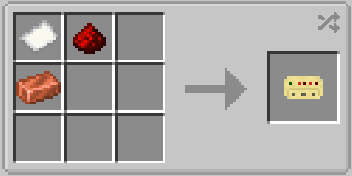
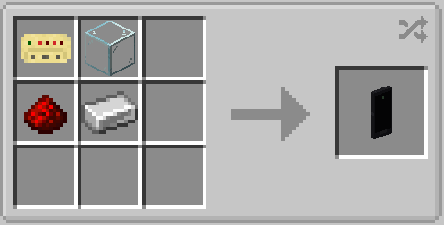

# Portable Monitor and Link Card

The Portable Monitor is a handheld screen. It streams the widget output of up to **8 computers**
without placing any monitor blocks — useful for drones, planes, or just checking your base from
your inventory.

## Crafting

**Link Card** — paper, redstone, and a copper ingot (shapeless):

{ width=420 }

**Portable Monitor** — a link card, glass, redstone, and an iron ingot (shapeless):

{ width=420 }

## Linking computers

- **Right-click a computer** with the Portable Monitor to add it as a channel. Right-click more
  computers to add more channels (up to 8; the same computer is never stored twice).
- **Shift-right-click a computer** to remove that computer from the channel list again.
- **Shift-right-click in the air** to clear all channels.

The item glows once it stores at least one channel, and its tooltip shows the linked position.

## Using the screen

**Right-click in the air** to open the display. It shows the widgets of the active channel exactly
like a wall monitor would — buttons, sliders, and text inputs are clickable.

- **Click a channel tab** (or press arrow left/right) to switch computers.
- **Right-click a channel tab** to remove that channel.
- **ESC** closes the screen; the game keeps running.

If the screen says *no signal*, the linked computer is probably not running a graph that feeds a
Monitor node — see [Monitors](monitors.md).

!!! note "Same widgets, smaller screen"
    The portable canvas is 256×144 pixels with 6 rows, while a wall monitor starts at 64×64 pixels
    per block. All 12 widget types work on both.

## Link Cards

A **Link Card** stores a reference to one computer:

- **Right-click a computer** to bind the card to it (the card glows and shows the position).
- **Shift-right-click in the air** to clear the binding.

Link cards have two uses:

1. **Copy a link:** hold a bound card in your offhand and shift-right-click the air while holding
   the Portable Monitor — the monitor replaces all its channels with just this one computer.
2. **Authorization:** anyone carrying a bound Link Card (in the inventory or offhand) can view and
   click the linked computer's displays, even from far away — there is no distance limit. This is
   what keeps drones and planes usable.

## Limits at a glance

| Limit | Value |
|---|---|
| Channels per monitor | 8 |
| Screen | 256×144 px, 6 rows |
| Update rate | About every 0.75 seconds, only when the picture changes |
| Widget clicks | Forwarded to the computer (buttons, sliders, text inputs) |
