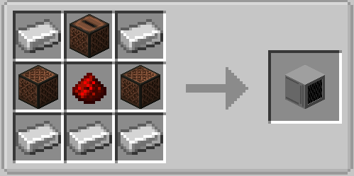

# Speaker

The Speaker block plays notes, sounds, generated waves, and music discs from your graph. Place up
to six speakers around one computer — one per side.

## Crafting

{ width=420 }

The speaker faces you when you place it. Right-click it with a music disc to insert the disc;
right-click it empty-handed to take the disc back.

## Addressing a speaker

Every speaker node has a **Face** field (`front` by default). It selects the side of the computer
the speaker sits on: `front`, `back`, `left`, `right`, `up`, `down` (also `north`, `east`, `south`,
`west`, `top`, `bottom`). The node errors if no speaker is on that side.

## The nine speaker nodes

Eight of them are triggers: they run when their **Trigger** input turns on or an event arrives.

| Node | What it does | Extra fields |
|---|---|---|
| **Play Note** | Plays one note-block note | Instrument (16 choices, default `harp`), Note 0–24 (default 12) |
| **Play Sound** | Plays any named sound | Sound ID (e.g. `block.note_block.pling`), Volume 0–4, Pitch 0.5–2 |
| **Play Wave** | Plays a synthesized waveform | Wave (`sine`, `square`, `saw`, `triangle`, `noise`), Frequency 55–3520 Hz, Volume 0–3, Attack 0–2 s, Decay 0–2 s |
| **Play Sweep** | Glides between two frequencies | Wave, From/To 55–3520 Hz, Duration 0.2–10 s, Volume |
| **Play Disc** | Starts the inserted music disc | Loop (restarts the disc at song end) |
| **Play Sequence** | Plays timed notes without a disc | Sequence (e.g. `harp:12:0.5 bell:18:0.5`) |
| **Stop** | Stops whatever is playing | — |
| **Eject** | Spits the disc out | — |
| **Speaker Status** | Reports the speaker state | Outputs: `has_disc`, `is_playing`, `is_looping`, `queued` (updates every tick) |

Example — play a doorbell note when a button is pressed:

1. Place a **Play Note** node, set **Instrument** to `bell` and **Note** to `18`.
2. Connect a button widget (or any boolean source) to **Trigger**.
3. Set **Face** to the side the speaker is on.

Example — an alarm that alternates two notes: drive **Trigger** from a fast
[counter](nodes.md) or [pulse](nodes.md) node and switch the note with an
[if branch](nodes.md).

### Disc playlist

Right-click a speaker with a music disc to queue it behind the inserted one — up to **8 discs**
wait in the playlist (`Speaker Status` reports them as `queued`).

- **Play Disc** starts the inserted disc; with the slot empty it pulls the first queued disc.
- When a song ends and discs are queued, the finished disc drops on the ground like a vanilla
  jukebox and the next queued disc starts.
- With **Loop** on, the playlist *cycles*: the finished disc joins the queue's end and the next
  one starts, forever.
- Empty-hand click or **Eject** removes only the inserted disc; the queue stays for next time.

### Note sequences

**Play Sequence** plays a little melody with its own timing — no disc, no clock nodes. The
sequence field takes `instrument:note:seconds` steps separated by spaces or commas; the seconds
value after a note is the gap until the next one:

```
harp:12:0.5 bell:18:0.5 pling:15:0.5
```

plays three notes, half a second apart. **Stop** cancels a running sequence. Instruments and
note range are the same as **Play Note**; each gap is 0–10 s and a sequence holds up to 64 notes.

### Envelopes, sweeps, and loops

- **Attack / decay** on **Play Wave** fade a tone in and out so notes do not cut off harshly.
  The envelope restarts the tone in short slices, so keep attack/decay at a few tenths of a
  second for the smoothest result.
- **Play Sweep** glides linearly from one frequency to another — risers, alarms, motors.
- **Loop** on **Play Disc** restarts the disc automatically when the song ends — with a
  playlist queued, it cycles through the discs instead. Turn it off (or hit **Stop**) to end
  playback; the **Speaker Status** node reports `is_looping`.

!!! note "One tone per speaker"
    Envelope slices and sweeps cut the previous slice before restarting, so overlapping wave
    tones on the *same* speaker (or the same waveform on several speakers) may cut each other.
    For polyphony, use one speaker per voice.

## Useful limits

| Limit | Value |
|---|---|
| Note range | 0–24 (12 = A, the default) |
| Note instruments | `harp`, `basedrum`, `snare`, `hat`, `bass`, `flute`, `bell`, `guitar`, `chime`, `xylophone`, `iron_xylophone`, `cow_bell`, `didgeridoo`, `bit`, `banjo`, `pling` |
| Wave frequencies | 55–3520 Hz |
| Wave aliases | `sin`→sine, `sq`→square, `sawtooth`→saw, `tri`→triangle, `white`→noise |
| Envelope range | Attack/decay 0–2 s each |
| Sweep range | 0.2–10 s, sliced every 0.1 s |
| Simultaneous discs | One inserted + 8 queued (playlist) |
| Sequence | Up to 64 notes, gaps 0–10 s each |
| Speakers per computer | Six (one per side) |

Timing is up to your graph: speaker nodes have no built-in wait — use a **Delay** node, drive
them from a tick-based counter, or let **Play Sequence** handle the timing itself.
